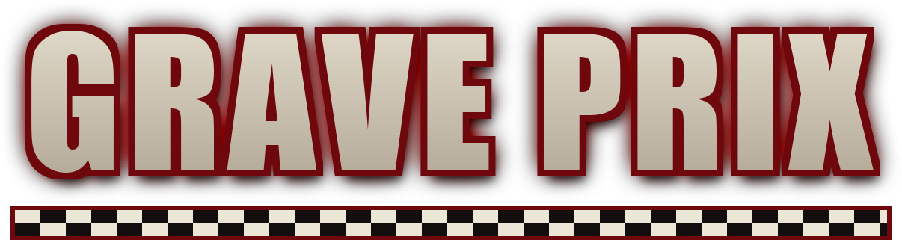
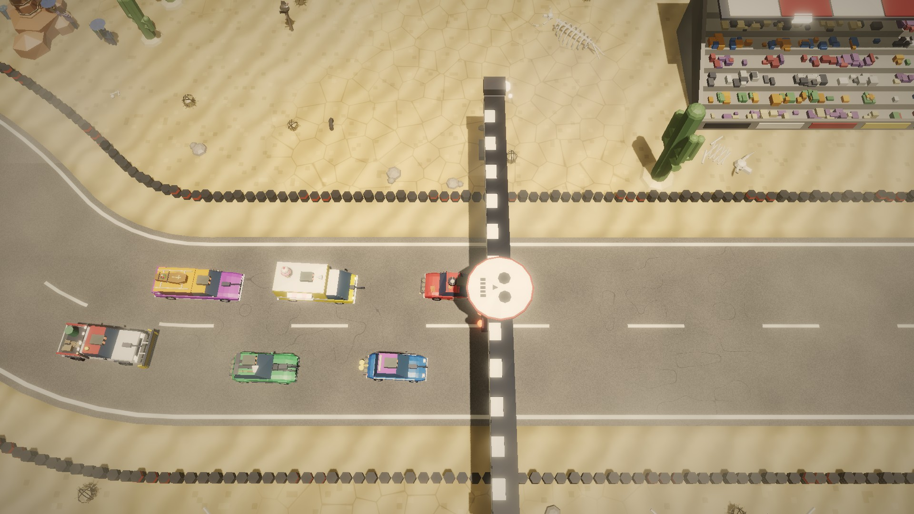
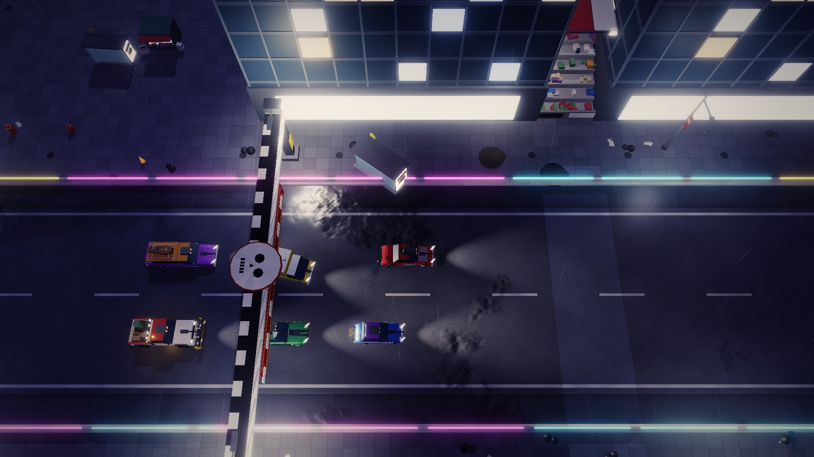
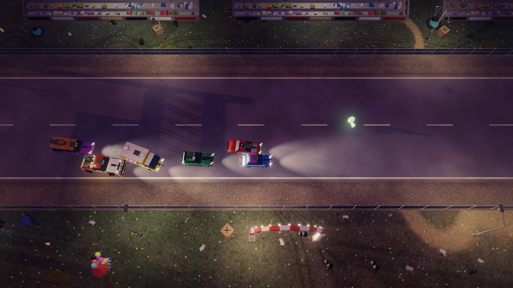
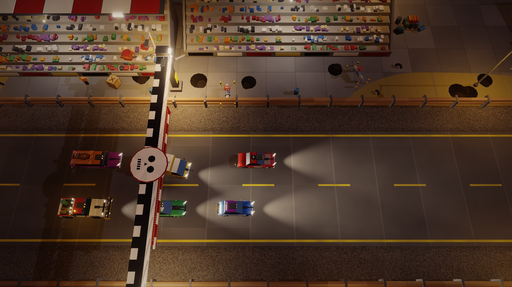
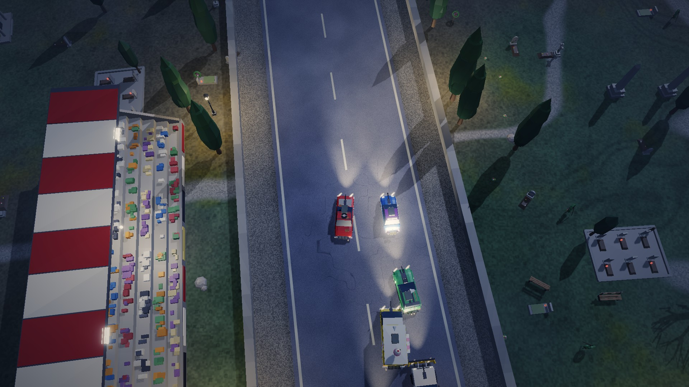

<h1 align="center"></h1>

<a href="https://reneweller-coding.itch.io/grave-prix"><b>itch.io</b></a> ·
<a href="https://github.com/reneweller-coding/GravePrix/releases/latest"><b>Download</b></a> ·
<a href="https://youtu.be/DjgqPVnbCdo"><b>Trailer</b></a> ·
<a href="https://youtu.be/Dxo9pljfuGk">Gameplay video</a> ·
<a href="LICENSE">AGPL-3.0</a>

A top-down combat racer with a career and black humour. Mortimer Graves, owner of the funeral group Graves & Sons,
runs an underground racing league and earns twice from every crash: from the bets and from the funerals. You start in
the lowest of five leagues with a rusty car and little money. Race, shoot, mine, ram, earn, upgrade, climb league by
league, beat each league's champion in a showdown, and at the top race Graves himself in his armoured hearse.

**Windows, Linux and the Steam Deck**, free and open source under the AGPL-3.0. Real-time 3D seen from above, six
cars on closed circuits; wrecks stay on the track, burning.

## Download

**[GravePrix-1.0.1-windows-x64.zip](https://github.com/reneweller-coding/GravePrix/releases/download/v1.0.1/GravePrix-1.0.1-windows-x64.zip)**
for Windows 10 and 11: unpack it anywhere and start `GravePrix.exe`, nothing to install. The
**[Linux archive](https://github.com/reneweller-coding/GravePrix/releases/download/v1.0.1/GravePrix-1.0.1-linux-x86_64.tar.gz)**
runs on any x86-64 distribution with glibc 2.35 or newer, SteamOS included (add `GravePrix` to Steam as a non-Steam
game). Both carry the player's readme (`README.txt`), the credits and the licence. The same packages are on
**[itch.io](https://reneweller-coding.itch.io/grave-prix)**.

A **[macOS archive](https://github.com/reneweller-coding/GravePrix/releases/download/v1.0.1/GravePrix-1.0.1-macos-arm64.zip)**
(Apple Silicon) is built by GitHub's runners; it is compiled and checked but has never been played on a Mac. It is
only ad hoc signed: right-click `GravePrix` and choose Open the first time.

Requirements: a graphics card with OpenGL 3.3; a gamepad or the keyboard. The program is not code-signed: Windows'
SmartScreen may warn once ("More info", "Run anyway").

## Videos

| | |
|:---:|:---:|
|  |  |
| The trailer (one minute) | Gameplay (several minutes, the game's autopilot at the controls) |

## Pictures

| | |
|:---:|:---:|
|  |  |
| Downtown at night, neon and wet streets | The fairground |
|  |  |
| The refinery | The start at the cemetery |

## The game

- **Career:** five leagues, race days with three offers each, prize money and bounties, a garage to buy and upgrade
  cars, a black market for weapons and sabotage, a loan shark, sponsors and the tabloid after every race day. Each
  league ends with a showdown against its champion and their own monster.
- **Weapons:** every car has a front gun and can carry mines, rockets, spikes, oil, smoke and nitro. Cash, wrenches,
  ammo and coffins (anything can be inside) lie on the track.
- **Rivals with a memory:** wreck one twice and you have a feud. Rivals who are wrecked may die; they get a stone in
  the Graveyard of Honour, with their last words, and a newcomer takes their seat.
- **Tracks that fight back:** level crossings and trains that do not brake, drawbridges, falling rocks on the pass,
  weather that turns in the middle of a race.
- **Jobs for Graves:** carry a coffin on the roof without losing it, wreck a debtor, see the firm's hearse home
  through a field that wants it dead, pick up the wreaths before the others flatten them.
- **A world that reacts:** bins, crates, grave crosses, garden gnomes and snowmen on the shoulders fly when hit,
  hydrants spout, spectators throw themselves flat, crows take off, yard dogs chase the field, and on the cemetery
  the dead rivals still race along as ghosts.
- **65 epitaphs** to earn, each a gravestone in the crypt; a test drive on the Graves & Sons yard teaches the controls;
  three career slots.
- **Other modes:** quick race (race, derby or time trial), an endless tournament on random tracks and a daily
  challenge, the same for everyone.
- **Five difficulties** and options for everyone: a driving assist (on by default), text and display sizes, colour
  vision settings, frame rate (40 saves battery on the Deck), vibration, camera height and screen shake.

## Controls

| | Keyboard | Pad / Steam Deck |
|---|---|---|
| Accelerate | Up / W | RT (analogue) |
| Brake / reverse | Down / S | LT (analogue) |
| Steer | Left/Right, A/D | left stick |
| Handbrake | Ctrl / B | B |
| Front gun | Space / J | A |
| Drop rear gear | E / K | X |
| Rocket | Q / L | Y |
| Nitro | Shift / I | RB |
| Next rear gear | Tab / R | LB |
| Horn | H | L3 |
| Pause | Esc / P | Start |
| Fullscreen | F11 (or Alt+Enter) | |
| Screenshot | F12 | |

Everything can be rebound under Options > Controls. Settings, career and records live in `%APPDATA%\GravePrix`
(Windows) or `~/.local/share/GravePrix` (Linux).

## Building

    .\build.ps1                    # Windows, MSVC: bin\msvc\GravePrix.exe
    bash Deploy/build_linux.sh     # Linux / Steam Deck (WSL Ubuntu 22.04, GCC 12): dist/GravePrix-<v>-linux-x86_64.tar.gz
    .\Deploy\build_release.ps1     # both packages into dist/

C++20 on raylib 5.5 (its sources in `third_party/raylib`, no download). The data (cars, tracks, leagues, rivals,
sponsors, the tabloid's news) is plain text in `data/`; [docs/DESIGN.md](docs/DESIGN.md) is the contract between the
engine and the content, with the test programs and their options.

## Credits and licence

[docs/CREDITS.txt](docs/CREDITS.txt) lists what GRAVE PRIX is made from: raylib (zlib/libpng licence), the Barlow
typeface (SIL Open Font License) and the tools the music, the announcer's voice and the tabloid's photos were made
with (ACE-Step 1.5, Qwen3-TTS, FLUX.2 [dev]). All characters, drivers, cars, places and firms are invented.

GRAVE PRIX is free software under the GNU Affero General Public License 3.0 ([LICENSE](LICENSE)): use it, change it,
pass it on, with the source of what you change.
